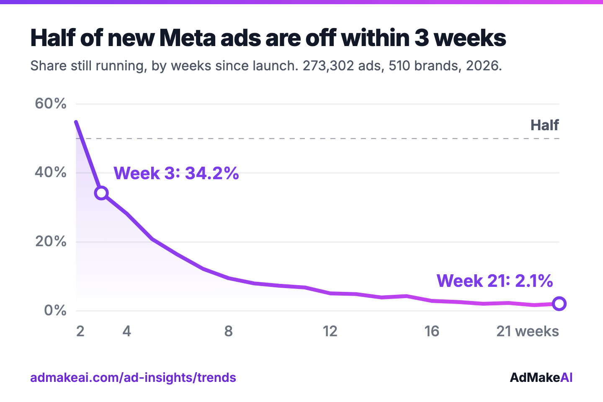
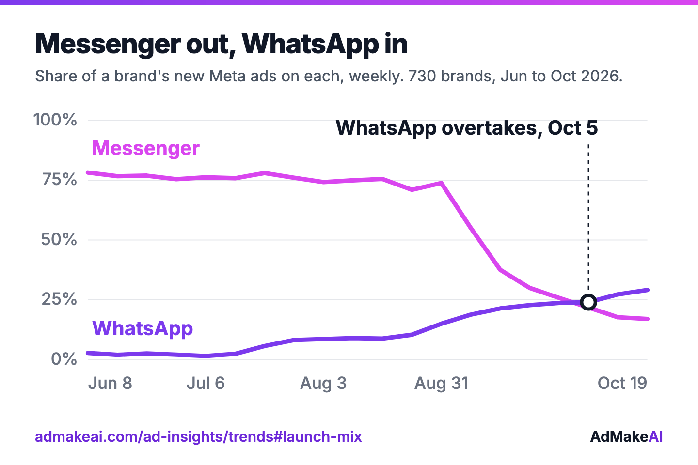

# Half of new Meta ads are switched off within 3 weeks

Open data on 538,068 new Meta ads from 730 brands, tracked week by week from June 8 to October 25, 2026, plus the longest-running ads still live and Black Friday 2026. 19 CSV tables, free to use under CC BY 4.0.

**[Download all files (ZIP)](https://github.com/mesmerlord/meta-ad-library-insights/archive/refs/heads/main.zip)** · [Column guide](DATA_DICTIONARY.md) · [Method](METHOD.md)



## What the data shows

- **28.2%** of new ads are still running 4 weeks after launch, and **2.1%** after 21 weeks.
- **Messenger: 76.8% → 20.6%.** That is the share of a brand's new ads placed on Messenger, first four weeks against the last four. WhatsApp went from 2.4% to 26.0%.
- **26%** of carousel ads are still running 4 to 7 weeks after launch, against 17.2% of single images.
- **539 new ads a week** from PrizePicks over the last four weeks, the most in the panel. The typical brand launches 16.
- **1,871 days**: the longest-running ad still live, from Seeking Alpha, running since September 19, 2021.
- **6,005** Black Friday ads were live on November 11, from 147 brands. The typical brand's ads say **45% off**.



Live, updated charts: [Trends](https://admakeai.com/ad-insights/trends) · [Longest-running ads](https://admakeai.com/ad-insights/longest-running-ads) · [Black Friday 2026](https://admakeai.com/ad-insights/black-friday-ads)

## Use it

```python
import pandas as pd

base = "https://raw.githubusercontent.com/mesmerlord/meta-ad-library-insights/main/data/"
curve = pd.read_csv(base + "trends_lifespan_curve.csv")
```

```r
base <- "https://raw.githubusercontent.com/mesmerlord/meta-ad-library-insights/main/data/"
curve <- readr::read_csv(paste0(base, "trends_lifespan_curve.csv"))
```

Every file is UTF-8 CSV with a header row. `scope` is `all`, `ecommerce`, `software` or `services`. Weeks are named by their Monday. Every column is described in [DATA_DICTIONARY.md](DATA_DICTIONARY.md).

<details>
<summary><b>All 19 files</b></summary>

| File | Rows | What it holds |
| --- | ---: | --- |
| `trends_summary.csv` | 4 | Panel size, sample sizes and headline figures, one row per scope |
| `trends_lifespan_curve.csv` | 64 | Share of new ads still running, by weeks since launch |
| `trends_lifespan_by_format.csv` | 14 | Share still running 4 to 7 weeks after launch, by format |
| `trends_lifespan_by_launch_week.csv` | 64 | Share of each launch week still running 4 weeks later |
| `trends_live_ads_by_age.csv` | 20 | Ads running at the latest check, by how long ago they launched |
| `trends_launch_mix_weekly.csv` | 1,120 | Weekly share of a brand's new ads in each format, placement and button |
| `trends_launch_mix_change.csv` | 56 | The same shares, first four weeks against last four |
| `trends_sale_calendar_weekly.csv` | 320 | Weekly share of new ads with a "% off", and with each seasonal event in the copy |
| `trends_sale_events.csv` | 12 | When each seasonal event's ads start and peak |
| `trends_launch_pace_weekly.csv` | 80 | New ads per brand per week: lower quartile, median, upper quartile |
| `trends_launch_weekday.csv` | 28 | Launches per weekday, relative to the busiest day |
| `trends_top_launchers.csv` | 15 | The five brands launching the most per market, latest four weeks |
| `longest_running_summary.csv` | 1 | Brands, live ads, and brands with an ad live for 1+ and 2+ years |
| `longest_running_by_industry.csv` | 36 | Brands per industry, and how many have an ad live for a year or more |
| `longest_running_ads.csv` | 108 | The three longest-running live ads in each industry, with the top 10 overall ranked |
| `black_friday_summary.csv` | 1 | Live Black Friday ads and brands, and the "% off" they state |
| `black_friday_first_ads_weekly.csv` | 15 | Brands launching their first Black Friday ad of the season, by week |
| `black_friday_pct_off_bands.csv` | 4 | Brands by the typical "% off" their Black Friday ads state |
| `black_friday_most_live_ads.csv` | 3 | The three brands with the most live Black Friday ads |

</details>

## Method in brief

- **Source:** the public Meta Ad Library. For each ad: its start date, format, placements, button and text, and when it was last seen running.
- **Brands:** the trends tables follow the same 730 brands every week, across 36 categories (385 ecommerce, 141 software, 204 services). The longest-running and Black Friday tables cover all 947 brands we publish.
- **Window:** ads launched June 8 to October 25, 2026 (20 weeks). The longest-running and Black Friday tables are as of November 11, 2026.
- **Still running:** an ad counts as running if it was seen live in one of the brand's last two weekly reads.
- **Limits:** ads are checked weekly, so real lifespans are slightly shorter than shown. "% off" and holiday figures read the ad text, not the image. The library shows no spend or results.
- **Snapshot:** taken November 10 and 11, 2026. The live pages keep updating, so their numbers move on from these files.

Full details, including sample sizes and thresholds: [METHOD.md](METHOD.md).

## How to cite

Cite the page a number comes from:

> AdMakeAI (2026). Meta Ad Trends: how Facebook and Instagram ads are changing, week by week. New ads from 730 brands in the Meta Ad Library, June 8 to October 25, 2026. https://admakeai.com/ad-insights/trends

> AdMakeAI (2026). The longest-running Meta ads. 947 brands in the Meta Ad Library, as of November 11, 2026. https://admakeai.com/ad-insights/longest-running-ads

> AdMakeAI (2026). Black Friday 2026 ads on Meta. 947 brands in the Meta Ad Library, as of November 11, 2026. https://admakeai.com/ad-insights/black-friday-ads

To cite the dataset itself, use [CITATION.cff](CITATION.cff) (GitHub's "Cite this repository" button reads it).

## Source and license

Built from public data in the Meta Ad Library. This dataset is not affiliated with, endorsed by or sponsored by Meta Platforms, Inc. Brand names belong to their owners.

Published by [AdMakeAI](https://admakeai.com) under [CC BY 4.0](LICENSE): share and adapt it for any purpose, with credit and a link to the source page.
